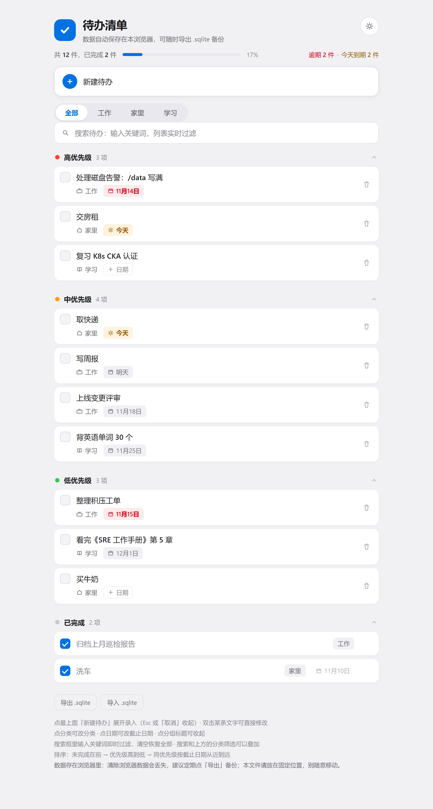
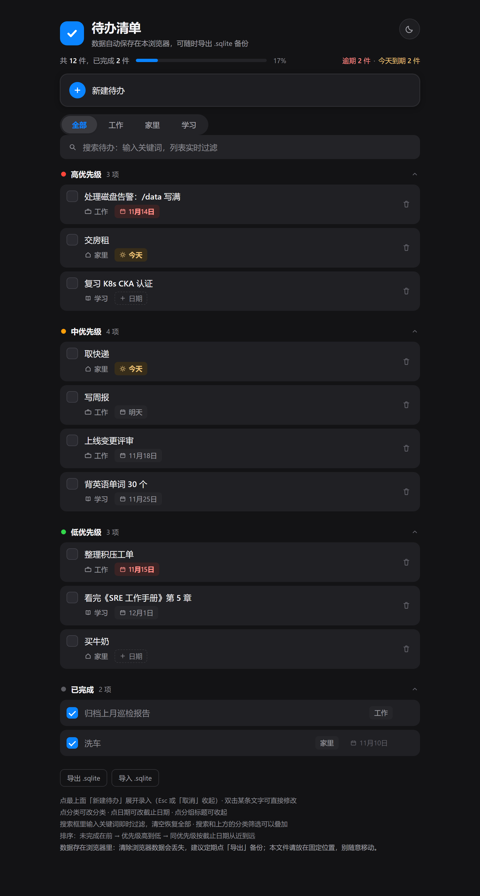
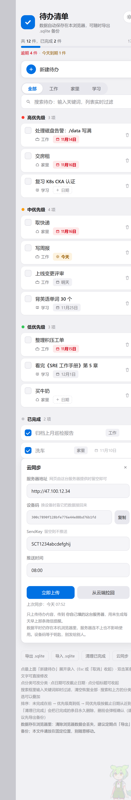

# 待办清单 · 一个 HTML 文件，双击就能用

一个**单文件网页待办清单**：HTML 里内嵌了完整的 SQLite 引擎（sql.js），打开就能用，不需要安装、不需要联网、不需要后端。数据存在你自己的浏览器里，导出的是一份**真正的 `.sqlite` 文件**——可以用 `sqlite3` 命令行、DB Browser 或任何工具打开。

可选再自建一台很小的服务器，就能变成**多用户**（一人一个目录、互相看不见）并且**每天早上收到一条微信待办汇总**。

> **直接用**：[点这里下载 `待办清单.html`](https://github.com/xiuweixiong/todo-list/raw/main/todo-app/%E5%BE%85%E5%8A%9E%E6%B8%85%E5%8D%95.html)（7.8MB，点开即下载，双击打开就是全部，不需要安装任何东西）。

<p>
  
  
</p>

<p>
  
</p>

## 为什么又造一个 todo

市面上的待办应用不缺。这个项目只关心三件事：

1. **数据必须能拿走。** 不是加密的 JSON 导出，就是一份标准 SQLite 文件，你随时能 `sqlite3 todos.sqlite "select * from todos"`。
2. **不想装任何东西。** 没有 Node、没有 npm、没有 docker-compose、没有后端服务。一个文件，拷到 U 盘里都能用。
3. **提醒要push到我已经在看的地方。** 不是又一个需要主动打开的 App，而是每天早上一条微信。

顺带解决一个运维日常：磁盘告警、变更评审、考证复习、家里买菜混在一张列表里时，光靠"重要/紧急"两个维度是不够的——所以有优先级、分类、截止日期三件套，并按优先级分组、已完成沉底。

## 特点

- **真 SQLite**：sql.js（WASM）内嵌在 HTML 里，7.8MB 一个文件，离线可用
- **零依赖**：浏览器打开就是全部；服务器端只有一个纯标准库的 Python 文件
- **优先级 / 分类 / 截止日期**：高·中·低分组，逾期标红、今天标黄，显示成「今天 / 明天 / 12月3日」
- **按优先级分组、已完成沉底**，组可收起；分类筛选与关键词搜索可以叠加
- **双击改字、点标签改分类/日期**，不弹模态框
- **深浅色**跟随手动切换，macOS 设置风格
- **导出 / 导入 `.sqlite`**，可导入标准 sqlite 工具产生的同结构库
- **多用户互不可见**：服务器上每人一个目录，目录名是设备码的 sha256 前 16 位
- **微信早报**：每人用自己的 [Server酱](https://sct.ftqq.com) SendKey，额度互不影响

## 用法一：只要本地使用

不需要服务器，也不需要构建——仓库里的 [`todo-app/待办清单.html`](https://github.com/xiuweixiong/todo-list/raw/main/todo-app/%E5%BE%85%E5%8A%9E%E6%B8%85%E5%8D%95.html) 就是成品，下载后双击打开即可。

想自己从头构建（改了界面、换了配色之类）：

```bash
python _build/build.py          # 生成 todo-app/待办清单.html 和 _deploy/index.html
```

想放到网站上，把 `_deploy/index.html` 丢进任意静态目录。

> 数据存在浏览器的 localStorage 里（键名 `todo_sqlite_db_v1`）。**清浏览器数据会丢**，所以界面上一直有个「导出 .sqlite」——定期点一下。

## 用法二：自建服务器（多用户 + 微信提醒）

一台 1C1G 的小机器就够，5～30 人无压力。

```
浏览器 ──→ NodePort 30080 ──→ nginx:80 ─┬─ /            → index.html（gzip，走 304）
                                        └─ /api/todos   → api.py:8099（收/发 sqlite）
                                                          │
cron 每 15 分钟 ──→ push-all.sh ──→ 遍历 users/*/ ──→ Server酱 ──→ 各自微信
```

- 网页和接口在**同一个 Pod** 里两个容器（nginx + api），中间走 `127.0.0.1`，不经过 Service
- 用户数据落在 PVC 上的一个目录里（k3s 默认 `local-path`，标准 k8s 跟随你的默认 StorageClass），一个用户一个目录：`todos.sqlite` / `conf` / `last.log`
- 推送每人每天一条，只推**「今天到期」和「已逾期」**，两类都没有就故意不发（省额度）
- 每人填自己的 SendKey，免费版每天 5 条按 key 各自计算，互不影响

部署步骤见 **[todo-push/k8s/README.md](todo-push/k8s/README.md)**。最小流程（k3s 和标准 k8s 都能跑，脚本自动识别容器运行时）：

```bash
python _build/build.py                         # 先生成网页
cd todo-push/k8s
./deploy.sh --html ../todo-app/待办清单.html    # build 镜像 → 导入 containerd → apply → 传网页 → 自检
./check.sh                                     # 逐项自检（集群/网页/gzip/304/接口闭环/推送重试）
```

不是 k3s？多两个可选参数：`--storage-class <名字>`（集群没有默认 StorageClass 时）、
`--registry <仓库前缀>`（多节点集群，镜像推私有仓库）。详细差异见那份 README 的第三节。

给使用者看的说明在 **[todo-push/用户引导.md](todo-push/用户引导.md)**，可以直接转发。

## 从源码构建

构建只需要 Python 3，不需要装 sql.js、不需要 npm。

```bash
python _build/build.py
```

它把 `template.html` 里的占位符替换成 base64 编码的 `sql-wasm.wasm` 和 JS，产出一个自包含的 HTML：

| 输入 | 作用 |
|---|---|
| `_build/template.html` | 界面 + 全部前端逻辑（HTML/CSS/JS） |
| `_build/sql-wasm.js` + `sql-wasm.wasm` | SQLite 引擎（[sql.js](https://github.com/sql-js/sql.js)） |
| `_build/live2d/*` | 右下角的看板娘（PixiJS + Live2D Cubism） |
| `_build/build.py` | 打包脚本 |

打包服务器部署包（转 LF、`.sh` 置 755、网页原样不动）：

```bash
python _build/pack_push.py
```

## 数据结构

一张表，七个字段。导出后用任何 SQLite 工具都能读：

```sql
CREATE TABLE todos (
  id         INTEGER PRIMARY KEY AUTOINCREMENT,
  content    TEXT NOT NULL,              -- 要做的事
  priority   INTEGER DEFAULT 1,          -- 2=高 1=中 0=低
  done       INTEGER DEFAULT 0,
  category   TEXT    DEFAULT '工作',      -- 工作/家里/学习
  due_date   TEXT,                        -- YYYY-MM-DD，可空
  created_at TEXT
);
```

服务器端对上传的库做三重校验（文件头 + `PRAGMA integrity_check` + `todos` 表存在），先写 `.tmp` 再原子改名，坏文件不会覆盖已有数据。

## 目录结构

```
.
├── _build/                 构建源码（template.html / build.py / sql.js / live2d）
├── todo-app/               成品单文件（可直接下载使用，由 _build 生成）
├── todo-push/              服务器端：api.py、推送脚本、Dockerfile、k8s 清单
│   ├── k8s/                部署与自检脚本
│   └── 用户引导.md          给使用者看的操作说明
├── docs/screenshots/       README 配图
└── 待办应用-设计卡.md        设计约定与验收标准
```

## 隐私

- 本地使用时，数据**从不发往任何服务器**
- 自建服务器时，只上传你自己的 sqlite 文件和推送配置，存进你自己的机器
- 服务器上的目录名是设备码的 sha256 前 16 位，磁盘上看不到明文设备码
- `conf` 与 `todos.sqlite` 权限 0600；但 SendKey 是明文存储的，能 root 上机器就能读到——这是单人自托管的固有代价，介意的话别用推送

## 已知取舍

- 数据在 localStorage，**同一个浏览器换不了设备**，要靠设备码 + 「从云端拉回」搬
- 单用户单 Pod、`Recreate` 策略，滚动更新会短暂打不开（换来的是不会两个 Pod 抢同一个卷）
- 推送是「到点后每 15 分钟检查一次」，不是准点触发，可能晚几分钟
- Server酱 免费版每天 5 条、失败也计数，重度使用需要自行升级

## License

[MIT](LICENSE)
